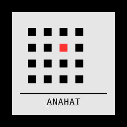

<p align="center">
  
</p>

<h1 align="center">ANAHAT // CYMATICS LAB</h1>

<p align="center">
  <strong>Real-Time Acoustic Resonance, Cymatic Waveforms & Mathematical Harmonics Synthesizer</strong>
</p>

<p align="center">
  <a href="https://www.producthunt.com/products/anahat?embed=true&amp;utm_source=badge-featured&amp;utm_medium=badge&amp;utm_campaign=badge-anahat"></a>
  <a href="https://coff.ee/jagadishk"></a>
  
  
  
  
  
</p>

---

## 1. Executive Summary

**Anahat** (_Sanskrit: अनाहत — "The Unstruck Sound"_) is a high-performance, background-first desktop neuroacoustic sound synthesizer and mathematical cymatics visualizer. Built with a raw industrial brutalist aesthetic, it bridges mathematical physics (Chladni resonance, Faraday fluid standing waves, 3D vortex curl noise) with neuroacoustic therapy (binaural beat induction, Solfeggio frequencies, modal physical-modeled Tibetan singing bowls, and autonomic breath synchronization).

Anahat operates as a zero-distraction ambient focus engine, a clinical relaxation tool, and an installation-grade fullscreen projection instrument.

---

## 2. Core Feature Matrix

### 🎛️ Algorithmic Audio Synthesizer

- **Pure Mathematical Synthesis:** 100% generated in real-time via the Web Audio API and Rust native audio pipeline (`rodio`, `hound`). Zero pre-recorded audio loops or static MP3 files.
- **30-Preset Scientific Provenance Catalog:** Hardcoded acoustic database spanning Vedic Solfeggio, planetary frequencies, circadian entrainment, Schumann resonances, and clinical EEG targets (Delta, Theta, Alpha, Beta, Gamma).
- **Dual Chladni Harmonic Modulator:** Live control of integer modal parameters ($n, m \in [1, 10]$) driving both harmonic carrier overtone intervals and 3D nodal geometries.
- **Stochastic Noise Generators:** Independent Brown, Pink, and White noise modulators with 2-pole resonant low-pass filters to roll off high-frequency transients.
- **Lossless Audio Recording:** One-click disk capture directly into uncompressed 32-bit float WAV via native OS file dialogs.

### 🔔 Tibetan Singing Bowl & Cadence Physical Modeling

- **Modal Resonance Physical Model:** Synthesizes an organic 40ms mallet strike impulse followed by 5 modal partials ($1.0 \times f_0$, $1.002 \times f_0$ beating pair, $2.01 \times f_0$ octave overtone, $2.76 \times f_0$ bronze shimmer, $3.82 \times f_0$ crystal sparkle) with stereo spatial dispersion.
- **Carrier Ducking:** Smoothly attenuates background noise and carrier drones by 22% during chime strikes for clean, non-clashing acoustic presence.
- **Sacred Breath Phase Tuning:** Automatically tunes interval chimes to sacred intervals based on active breathing phase: Inhale (528 Hz), Hold-In (594 Hz), Exhale (432 Hz), Hold-Out (396 Hz).
- **Toggleable Cadence Chime:** Off by default; toggleable via master switch or hotkey `B`.

### 🌌 11 GPU-Accelerated WebGL Visualizer Engines

1. **Chladni Plate Resonator:** 10,000 GPU particles migrating toward nodal curves based on the Ernst Chladni nodal plate equation:
   $$\nabla^2 \psi + k^2 \psi = 0 \implies Z = \sin(n \pi x)\sin(m \pi y) \pm \sin(m \pi x)\sin(n \pi y)$$
2. **Faraday Fluid Dynamics:** 512×512 vertex-displaced mesh simulating standing surface gravity waves on a fluid layer.
3. **Quantum Nodal Field:** Volumetric 3D density matrix mapping probability distributions under harmonic frequency excitation.
4. **Lissajous Orbit:** Multi-frequency phase-portrait curve generator rendering harmonic interference knots in 3D.
5. **Waterfall 3D Spectrogram:** High-resolution cascade terrain mapping historical FFT spectrum over time.
6. **Winamp Oscilloscope:** Multi-trace dual-channel audio oscilloscope tracking time-domain waveform, upper harmonic ribbon, and sub-bass resonance.
7. **Torus Vortex:** Audio-reactive magnetic plasma confinement toroid with dynamic harmonic streamlines.
8. **Voxel Matrix:** 3D cubic lattice grid pulsating with audio-reactive displacement and FFT intensity mapping.
9. **Warp Tunnel:** 16-rib perspective corridor with individual neon rib colors and gradient-interpolated bridging rings.
10. **Neon Wire Tunnel:** Wireframe cyber conduit with dynamic depth attenuation and bass-reactive lattice opacity.
11. **Ethereal Mist:** 36 short, spiraling smoke wisps spawning throughout the canvas volume with multi-octave 3D vortex curl noise, soft Gaussian blurry puff sprites, live beat pulsing, and dark/light tone adaptation.

### 🎨 6 Harmonic Chromatic Palettes

- `stark`: High-contrast industrial neon (Stark Neon Crimson `#FF1433`, Electric Cyan `#00E5FF`, Hot Magenta `#FF0D86`).
- `pastel`: Gentle therapeutic luminescence (Rose Coral `#F561B8`, Sky Blue `#62C0F7`, Mint Green `#72E1B8`, Gold `#FFDC73`).
- `amber_crt`: Vintage 589nm laboratory amber phosphor (`#FFB000`).
- `green_crt`: Classic P1 oscillographic green phosphor (`#33FF33`).
- `cyber_blue`: High-energy electric cyberspace cyan-blue (`#00F0FF`).
- `monochrome`: Brutalist minimalist high-contrast `#FFFFFF` / `#000000` with crimson indicators.

### 🫁 Breath Synchronization & Timebox Session Engine

- **Autonomic Cadence Controller:**
  - `BOX`: Box Breathing (4s Inhale, 4s Hold, 4s Exhale, 4s Hold) — resets cortisol and hones laser focus.
  - `478`: 4-7-8 Relax (4s Inhale, 7s Hold, 8s Exhale) — activates parasympathetic vagal toning.
  - `COHERENT`: Coherent Breathing (5s Inhale, 5s Exhale) — achieves 0.1 Hz heart-rate variability resonance.
  - `OFF`: Non-cadenced freeform audio synthesis.
- **Direct Master Sync Switch:** Dedicated LED toggle switch to instantly engage or disengage breath synchronization without opening dropdowns.
- **Dedicated Timebox Row:** Full-width duration selection for `10 MIN`, `20 MIN`, `60 MIN`, or continuous `∞ CONT` flow.

### 🖥️ Native Desktop Architecture

- **Custom Industrial Titlebar:** Integrated `/logo.svg` emblem, preset badge, live audio input toggles, Hotkeys overlay button, info modal, minimize to tray (`—`), and exit (`✕`).
- **System Tray Minimization:** Minimizes to system tray icon; left-click or tray menu restores and focuses the window.
- **Fullscreen Theater Mode:** Distraction-free chromeless projection mode with locked-dimension HUD toolbar and ESC escape key.
- **Interactive 3D Camera:** Left-click drag to rotate perspective, wheel to zoom, double-click or hotkey `R` to instantly reset to canonical front view.

---

## 3. Keyboard Shortcuts

| Key                 | Action                                                  |
| :------------------ | :------------------------------------------------------ |
| `Space`             | Toggle Audio Engine Playback / Pause                    |
| `1` – `9`, `0`, `E` | Directly select Visualizer Engine (1–11)                |
| `[` / `]`           | Cycle Previous / Next Visualizer Engine                 |
| `M`                 | Open Visualizer Engine Matrix Overlay                   |
| `T`                 | Toggle Fullscreen Theater Mode                          |
| `C`                 | Cycle Harmonic Color Palette (6 Palettes)               |
| `S`                 | Cycle Random Mode Timer (`OFF` → `15S` → `30S` → `60S`) |
| `D`                 | Cycle Detail Density (`LOW` → `MED` → `HIGH`)           |
| `+` / `-`           | Zoom Visualizer Scale In / Out                          |
| `R`                 | Reset 3D Camera Perspective & Zoom                      |
| `Z`                 | Maximize / Restore Canvas Viewport                      |
| `B`                 | Toggle Tibetan Singing Bowl Interval Chimes             |
| `I`                 | Toggle Audio Input (Synth / Mic FFT)                    |
| `O`                 | Open Audio Routing & DSP Matrix                         |
| `P`                 | Open Custom Acoustic Preset Designer                    |
| `?` or `H`          | Open Command Matrix Hotkeys Help                        |
| `Esc`               | Exit Theater Mode / Close Open Modals                   |

---

## 4. Technical Architecture

```
┌────────────────────────────────────────────────────────────────────────┐
│                          ANAHAT ARCHITECTURE                           │
└────────────────────────────────────────────────────────────────────────┘

  ┌─────────────────────────────────┐   ┌────────────────────────────────┐
  │     ASTRO 5 / TAILWIND v4       │   │        WEB AUDIO API DSP       │
  │ • Utilitarian Brutalist UI      │   │ • Stereo Binaural Carrier      │
  │ • Provenance Spec Cards         │   │ • Stochastic Noise Generators  │
  │ • Breath Cadence Controller     │   │ • Tibetan Singing Bowl Model   │
  │ • TitleBar & Tray Integration   │   │ • 32-bit Float WAV Recorder    │
  └────────────────┬────────────────┘   └───────────────┬────────────────┘
                   │                                    │
                   ▼                                    ▼
  ┌──────────────────────────────────────────────────────────────────────┐
  │                   WEBGL 2.0 / THREE.JS R170 ENGINE                   │
  │ • GPGPU Ping-Pong Buffers (10,000 Chladni Particles)                 │
  │ • Faraday Standing Wave Vertex Shaders (512x512 mesh)                │
  │ • 3D Vortex Curl Smoke & Ethereal Mist Particle Plumes               │
  │ • NormalBlending Dynamic Contrast (Paper-White & Onyx-Dark)          │
  └────────────────────────────────┬─────────────────────────────────────┘
                                   │
                                   ▼
  ┌──────────────────────────────────────────────────────────────────────┐
  │                         TAURI v2 RUST CORE                           │
  │ • High-performance native windowing without OS decorations           │
  │ • Native system tray lifecycle (`main-tray`)                         │
  │ • Audio buffer disk capture via `rodio` & `hound`                    │
  │ • Native OS File Dialogs (`@tauri-apps/plugin-dialog`)               │
  │ • Cross-platform targets: macOS (Apple Silicon/Intel), Windows, Linux │
  └──────────────────────────────────────────────────────────────────────┘
```

---

## 5. Development & Build

### Prerequisites

- **Node.js**: v18.0.0 or higher (`v20+` recommended)
- **Rust & Cargo**: Latest stable (`1.75+`)
- **OS Build Tools**:
  - macOS: Xcode Command Line Tools (`xcode-select --install`)
  - Windows: Visual Studio C++ Build Tools
  - Linux: `libwebkit2gtk-4.1-dev`, `build-essential`, `curl`, `wget`, `file`, `libssl-dev`, `libgtk-3-dev`, `libayatana-appindicator3-dev`, `librsvg2-dev`

### Installation & Commands

```bash
# Clone the repository
git clone https://github.com/projects-jagadishk/anahat.git
cd anahat

# Install frontend dependencies
npm install

# Run frontend in Astro development server
npm run dev

# Run full native desktop app in Tauri dev mode
npm run tauri:dev

# Run type check and verify build
npx tsc --noEmit
npm run build

# Package desktop application for release
npm run tauri:build
```

---

## 6. Project Directory Structure

```
anahat/
├── docs/                        # Complete product & architecture specifications
│   ├── BUILD_PLAN.md            # Technical milestones & feature roadmap
│   ├── DESIGN_BRIEF.md          # Brutalist UI tokens & Figma specifications
│   ├── DISTRIBUTION.md          # Multi-platform release & distribution guide
│   └── PRD.md                   # Product Requirements Document
├── public/                      # Static assets, fonts, icons, sound presets
│   ├── logo.svg                 # Brutalist Anahat vector emblem
│   └── presets.json             # 30-preset scientific provenance catalog
├── src/
│   ├── components/
│   │   ├── logic/
│   │   │   ├── AudioEngine.ts   # Web Audio API real-time DSP & singing bowl synthesis
│   │   │   ├── CadenceController.ts # Respiration state-machine & breath sync
│   │   │   └── ChladniCanvas.ts # WebGL Three.js visualizer engines (1-11)
│   │   └── ui/
│   │       ├── TitleBar.astro   # Custom window controls & system tray integration
│   │       └── ...
│   └── pages/
│       └── index.astro          # Main brutalist neuroacoustic laboratory deck
├── src-tauri/                   # Rust native backend & platform bindings
│   ├── src/
│   │   ├── main.rs              # Tauri entry point
│   │   └── lib.rs               # Commands: minimize to tray, window close, disk WAV export
│   ├── icons/                   # Multi-resolution icons (macOS .icns, Windows .ico, PNG)
│   ├── tauri.conf.json          # Tauri v2 bundle configuration
│   └── Cargo.toml               # Rust dependencies (rodio, hound, serde, tauri)
├── website/                     # Standalone static landing & download website
│   ├── index.html               # Brutalist single-page static site
│   └── logo.svg                 # Vector emblem
└── package.json                 # v1.0.0 Golden Master configuration
```

---

## 7. Maker, Architecture Services & Support

### 🛠️ Built by Jagadish Kasi

Hi, I'm **Jagadish Kasi** — a Frontend Architect specializing in building engaging, high-performance web and desktop applications. My engineering focus centers on high-throughput 3D WebGL / Three.js graphics, low-latency DSP audio synthesis, canvas physics simulations, bespoke brutalist design systems, and cross-platform native desktop architectures with Tauri v2 and Rust.

- **Looking for a Frontend Architect?**  
  I am available for technical architecture consulting, fractional advisory, and building high-impact interactive products that stand out from generic software. Let's connect:
  - **Work Experience:** [jagadishk.work](https://jagadishk.work)
  - **Product Hunt Profile:** [@jagadishk](https://www.producthunt.com/@jagadishk)
- **Support the Project:**  
  If Anahat aids your deep work or you appreciate handcrafted mathematical software without tracking, bloat, or subscriptions, you can fuel future development by buying me a coffee:
  - **Buy Me A Coffee:** [coff.ee/jagadishk](https://coff.ee/jagadishk)

---

## 8. Credits & Authorship

Made with 🫨 ☕ ❤️ 🤖 by **Jagadish Kasi**.

_Solae scientiae gloria. // Pure Sound, Mathematical Resonance._
